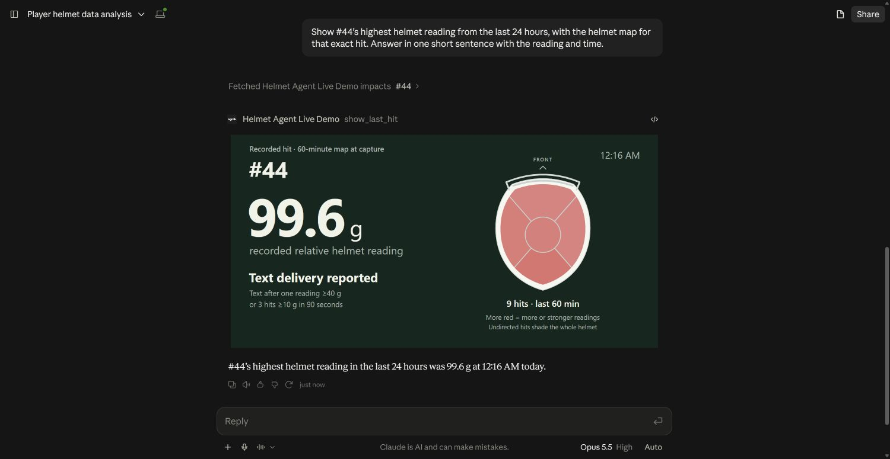
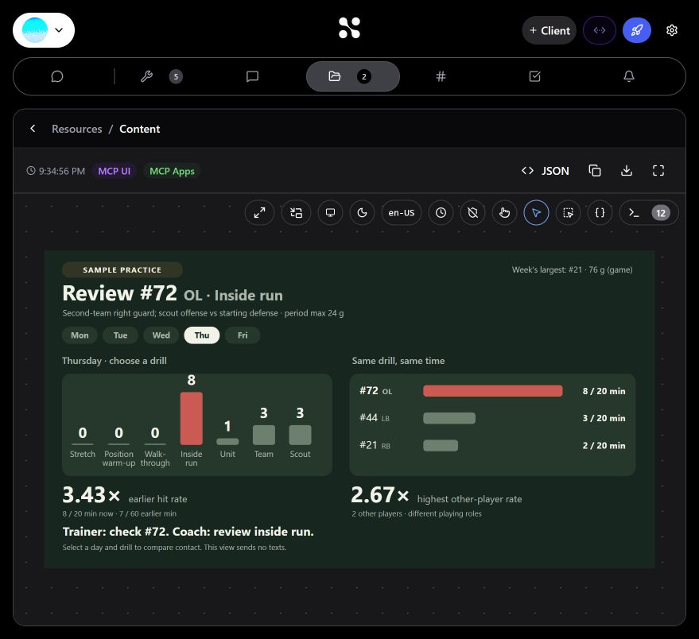
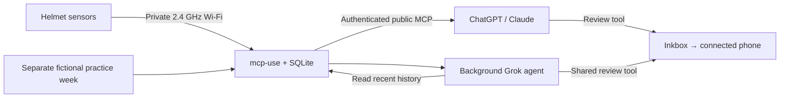

# Thump

**Give the trainer a player to check and the records behind it.**

*Give agents a sense of touch.* Thump connects a real football helmet
to an agent that checks recent history when review rules flag a reading or a
short cluster, then sends a specific request to the trainer's phone. ChatGPT
and Claude can retrieve the same events, show the helmet map and answer
follow-up questions. Smaller isolated events stay in history without a text.

**[Run the demo](docs/DEMO.md)** ·
**[Open the inspector on the demo laptop](http://localhost:3000/inspector)** ·
**[Two-minute walkthrough](docs/AGENT_VALUE.md)**

**Demonstrated on the assembled helmet:** a filmed empty-helmet drop recorded
**99.6 g at the shell sensor** as saved event **42**, started an agent history
check and sent a **“Check #44”** text. The user confirmed the message arrived;
Claude retrieved the same event and displayed its matching helmet map.
[Inspect the receipt](evidence/filmed-demo-event-check.json).



## From contact to follow-up

A trainer needs to know which player to check, what happened recently and what
triggered the request. Thump connects those steps:

1. **Record the event.** The helmet sends its sensor reading over Wi-Fi. The
   server saves the player, time, motion data and capture quality under a stable
   impact ID.
2. **Check the history.** A reading or short cluster that meets the review rules
   starts a background agent. It reads recent events before requesting review.
3. **Reach the trainer.** The connected phone receives the player, reading, time
   and reason to check. Cooldowns and duplicate protection control repeat texts.
4. **Keep asking questions.** Open ChatGPT or Claude to inspect recent events,
   see the helmet map or request review of a specific saved hit.

The live card shows the latest reading beside a white helmet on dark green.
Readings accumulate as red over a rolling 60 minutes. Detected directions add to
their zone; undirected hits shade the whole helmet and count once. The map
refreshes every ten seconds while visible. Full sensor records remain available.

## Find the pattern behind the hits

The labeled sample practice week shows the next question an agent can
investigate: **which player is recording repeated contact, and during which drill?**

Offensive lineman **#72** records **8 contacts in 20 minutes** of Thursday inside
run, compared with **7 in 60 minutes** across his earlier inside-run periods.
That's **3.4× his earlier contact rate**. Two other players record three and two
contacts in the same 20-minute period; their different playing roles are shown.

All eight of #72's readings are **14–24 g**, below the default 40 g
single-reading demo setting. Ask about repeated contact and the agent brings
back #72, inside run and the records supporting the comparison.

**The trainer gets a player to check. The coach gets a practice period to review.**

With **Helmet Agent Live Demo** enabled, ask:

> In the simulated week, who should the trainer check after Thursday practice,
> and why? Compare earlier drills and the other players in that period, then
> show the practice view. Do not send a text.



Select a day and drill in the practice view to explore the comparison. This
walkthrough uses fictional players and events, stored separately from live
helmet history. The sample view sends no texts.

## What the agent adds

The helmet makes a physical event available through MCP. Code qualifies a
candidate for review; the agent reads history and prepares the request. ChatGPT
and Claude use the same records for follow-up questions and visuals. The sample
week extends that investigation to drills and peer comparisons.



Manufact's **mcp-use** runs the server, MCP tools and inline widgets. **ngrok**
provides its fixed HTTPS entrance. **Inkbox** delivers the requested iMessage.
The receiver stays on the laptop's private helmet network.

| MCP tool | What someone can ask it to do |
| --- | --- |
| `get_impacts` | Read live hits by time, player or reading. |
| `show_last_hit` | Show the latest saved hit on the helmet. |
| `flag_for_review` | Text the connected trainer about a specific live hit. |
| `exposure_load` | Investigate contact by player and drill, with supporting records. |
| `show_practice_week` | Explore the simulated practice week by day and drill. |

## Try it on the demo laptop

Start the configured Windows system with one command:

```powershell
.\tools\Start-Helmet.ps1
```

Or double-click **Start Helmet.cmd**. Leave its window open, then:

1. Double-click **Check Helmet.cmd** to check the connection, automatic worker,
   public MCP access and widget resources without creating hits or sending texts.
2. Open ChatGPT or Claude with **Helmet Agent Live Demo** enabled. Follow the
   [demo runbook](docs/DEMO.md) for the supported empty-helmet tap and phone alert.
3. Ask **“Any hits in the last 10 minutes?”**, then **“Show me the last hit.”**
4. Switch explicitly to the sample week and use the practice prompt above.

The number is a helmet sensor reading. Review settings control when to request
a check; the trainer decides the response. Measurement validation, mounting
qualification and deployment work are documented in [engineering bottlenecks](docs/BOTTLENECKS.md).

## Find things

| Need | Open |
| --- | --- |
| What's verified, what's next | [CURRENT_STATE.md](CURRENT_STATE.md) |
| Stage sequence, prompts and recovery | [Demo runbook](docs/DEMO.md) |
| Automatic worker, limits and recovery | [Automatic reviews](docs/AUTOMATIC_ALERTS.md) |
| Folders, configuration and development | [Project map](docs/PROJECT_MAP.md) |
| Receipts and screenshots | [Evidence index](evidence/README.md) |
| Engineering bottlenecks and next validation | [Engineering notes](docs/BOTTLENECKS.md) |
| Server/API/practice details | [Server guide](server/README.md) |
| Existing ChatGPT/Claude connections | [Connect agents](server/CONNECT_AGENTS.md) |
| Sensor setup, calibration, diagnostics | [Firmware guide](firmware/README.md) |
| Compare light, medium and firm taps with existing hardware | [Completed back/front results](evidence/tap-comparison-results.html) — 18 attempts, 17 waveforms |

The project's scripts and instructions assume the configured Windows laptop.
Secrets stay in ignored local files or the Windows encrypted store. The complete
MCP connection URL is private; copy it from the launcher when connecting a client.

Start with the [two-minute walkthrough](docs/AGENT_VALUE.md): record the event,
show the context and put the review request on the trainer's phone.
